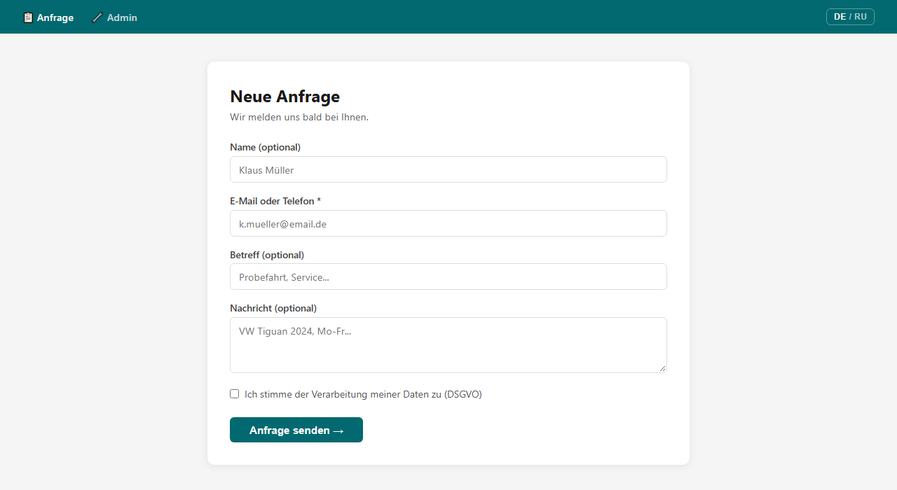
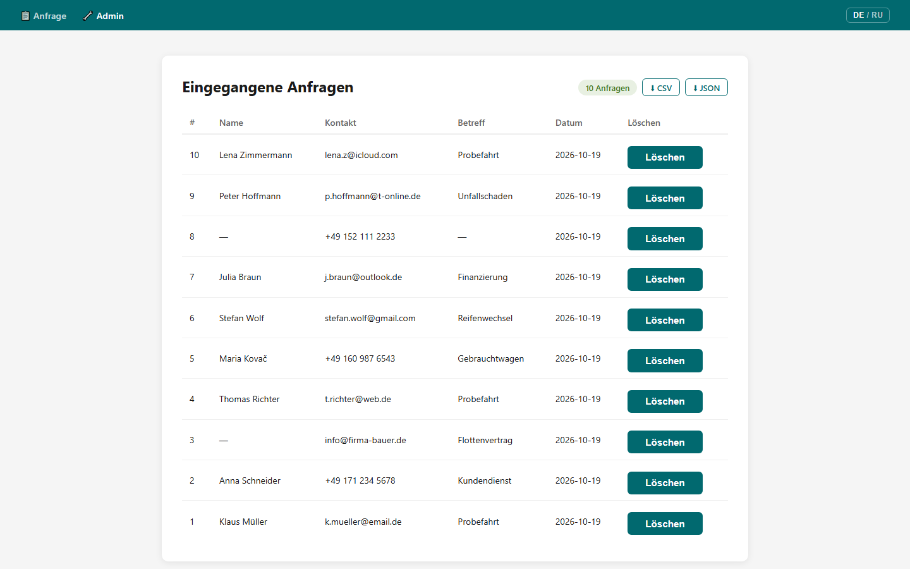
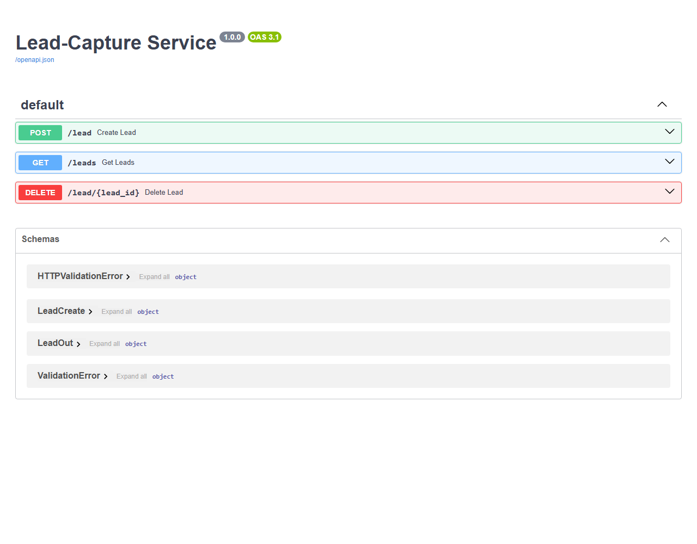

[English](README.md) · **Deutsch** · [Русский](README.ru.md)

# Lead-Capture Service

Ein MVP-Dienst zur Erfassung von Anfragen (Leads) von Kunden. Er enthält ein Webformular für Kunden und eine Manager-Seite zum Ansehen, Löschen und Exportieren der Anfragen. Die Daten werden in SQLite gespeichert, der Manager wird per Logdatei und E-Mail benachrichtigt, und jede Anfrage wird zusätzlich in eine Google-Tabelle übertragen.

## Screenshots

| Anfrageformular für Kunden | Manager-Seite |
|---|---|
|  |  |

<details><summary>Swagger UI (REST API)</summary>


</details>

Die Oberfläche ist auf Deutsch, mit Umschalter DE/RU.

**Stack:** Python 3.11+, FastAPI, Pydantic v2, SQLite, Jinja2, uvicorn

**Funktionen:**
- Webformular für Kunden + Manager-Seite
- Speicherung in SQLite
- Benachrichtigungen: Logdatei, E-Mail an den Manager, automatischer Eintrag in Google Sheets
- Export der Anfragen als CSV und JSON
- REST API mit Authentifizierung per API-Schlüssel
- DSGVO: Einwilligung, Recht auf Löschung, Daten auf dem eigenen Server

---

## In 5–10 Minuten startklar

### 1. Klonen und Abhängigkeiten installieren

```bash
git clone https://github.com/vikmi1/MVP-Lead-Manager.git
cd MVP-Lead-Manager
pip install -r requirements.txt
```

### 2. Konfigurieren

```bash
cp .env.example .env
```

API-Schlüssel erzeugen:

```bash
python -c "import secrets; print(secrets.token_hex(32))"
```

In `.env` als `API_KEY=...` eintragen.

Variablen in `.env`:

| Variable | Zweck | Erforderlich |
|---|---|---|
| `API_KEY` | Schlüssel für die geschützten Endpunkte `/leads`, `/lead/{id}` | ja |
| `SMTP_HOST` / `SMTP_PORT` | SMTP-Server (Standard `smtp.gmail.com:587`) | für E-Mail |
| `SMTP_USER` / `SMTP_PASS` | Login und App-Passwort des Absender-Postfachs | für E-Mail |
| `MANAGER_EMAIL` | Empfänger der Benachrichtigungen über Anfragen | für E-Mail |
| `SHEETS_WEBHOOK_URL` | URL der Apps-Script-Web-App | für Google Sheets |
| `DB_PATH` / `LOG_PATH` | Pfad zur Datenbank und zur Logdatei | nein (Standardwerte vorhanden) |

E-Mail und Google Sheets sind optional: Sind die Variablen leer, überspringt der Dienst diese Benachrichtigungen einfach. Die Einrichtung ist in den folgenden Abschnitten beschrieben.

### 3. Server starten

```bash
uvicorn app:app --reload
```

| Seite | URL |
|---|---|
| Formular für Kunden | http://localhost:8000 |
| Manager-Seite | http://localhost:8000/admin |
| Swagger UI | http://localhost:8000/docs |

### 4. Testanfrage

```bash
curl -X POST http://localhost:8000/lead \
  -H "Content-Type: application/json" \
  -d '{"contact": "test@example.de", "consent": true}'
```

---

## Weboberfläche

| Seite | Pfad | Beschreibung |
|---|---|---|
| Formular | `/` | Der Kunde gibt seine Kontaktdaten ein und erteilt die DSGVO-Einwilligung |
| Manager | `/admin` | Tabelle der Anfragen, Schaltfläche „Löschen", Exportschaltflächen CSV/JSON |

Das Formular sendet die Daten per JavaScript `fetch()`, ohne die Seite neu zu laden. Die Schaltfläche „Löschen" auf der Manager-Seite löscht den Eintrag und aktualisiert die Tabelle.

---

## Datenexport

Auf der Seite `/admin` gibt es die Schaltflächen „⬇ CSV" und „⬇ JSON" zum Herunterladen aller Anfragen.

| Methode | Pfad | Beschreibung |
|---|---|---|
| GET | `/admin/export.csv` | Alle Anfragen als CSV herunterladen (mit BOM – Umlaute werden in Excel korrekt angezeigt) |
| GET | `/admin/export.json` | Alle Anfragen als JSON herunterladen |

---

## E-Mail-Benachrichtigungen (Gmail)

1. Im Google-Konto des Absenders die **Bestätigung in zwei Schritten** aktivieren
2. Ein **App-Passwort** erstellen: https://myaccount.google.com/apppasswords (16 Zeichen)
3. In `.env` eintragen:
   ```
   SMTP_HOST=smtp.gmail.com
   SMTP_PORT=587
   SMTP_USER=du@gmail.com
   SMTP_PASS=<16-stelliges App-Passwort ohne Leerzeichen>
   MANAGER_EMAIL=empfaenger@gmail.com
   ```
4. Server neu starten. Bei jeder neuen Anfrage erhält der Manager eine E-Mail „Neue Lead-Anfrage #N".

Das normale Gmail-Passwort funktioniert nicht – es wird ausdrücklich ein App-Passwort benötigt.

---

## Google Sheets (Apps-Script-Webhook)

1. Eine Google-Tabelle mit den Spaltenköpfen anlegen: `Datum | ID | Name | Kontakt | Betreff | Nachricht | Consent`
2. **Erweiterungen → Apps Script**, folgenden Code einfügen:
   ```javascript
   function doPost(e) {
     var sheet = SpreadsheetApp.getActiveSpreadsheet().getActiveSheet();
     var data = JSON.parse(e.postData.contents);
     sheet.appendRow([
       new Date(), data.id, data.name, data.contact,
       data.source, data.comment, data.consent
     ]);
     return ContentService
       .createTextOutput(JSON.stringify({status: "ok"}))
       .setMimeType(ContentService.MimeType.JSON);
   }
   ```
3. **Bereitstellen → Neue Bereitstellung** → Typ „Web-App", Zugriff „Jeder"
4. Die URL kopieren (endet auf `/exec`) und in `.env` eintragen:
   ```
   SHEETS_WEBHOOK_URL=https://script.google.com/macros/s/.../exec
   ```
5. Server neu starten. Jede Anfrage wird automatisch als neue Zeile in die Tabelle geschrieben.

---

## API

| Methode | Pfad | Zugriff | Beschreibung |
|---|---|---|---|
| POST | `/lead` | öffentlich | Neue Anfrage anlegen |
| GET | `/leads` | X-API-Key | Liste aller Anfragen |
| DELETE | `/lead/{id}` | X-API-Key | Anfrage löschen (DSGVO) |

Vollständige Dokumentation: http://localhost:8000/docs

---

## API-Schlüssel wechseln

1. Einen neuen erzeugen: `python -c "import secrets; print(secrets.token_hex(32))"`
2. `API_KEY` in `.env` ersetzen
3. Neu starten: `uvicorn app:app --reload`

---

## DSGVO / Datenschutz

- Das Feld `consent: true` ist Pflicht – es dokumentiert die ausdrückliche Einwilligung des Nutzers
- `DELETE /lead/{id}` setzt das Recht auf Löschung um (Art. 17 DSGVO)
- `.env` und `leads.db` werden nicht in git eingecheckt (`.gitignore`)
- Empfohlene Speicherdauer: **90 Tage**
- Hosting nur auf Servern in Deutschland / der EU (Hetzner, STRATO, netcup)
- HTTPS ist im Produktivbetrieb Pflicht (Let's Encrypt)
- Ein Link zur Datenschutzerklärung muss neben dem Formular auf der Website des Kunden stehen
- ⚠️ Bei aktivierter Google-Sheets-Integration werden die Anfragedaten an Server von Google (USA) übertragen. Für strikte DSGVO-Konformität muss das in der Datenschutzerklärung erwähnt oder die Integration deaktiviert werden (`SHEETS_WEBHOOK_URL` leer lassen)
